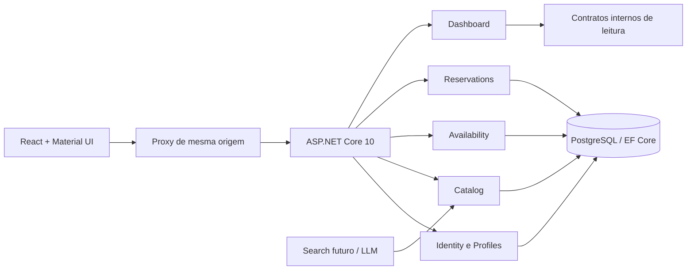

# Tech Spec — Autoluguel

Versão 0.1 · Estado: arquitetura alvo e scaffold inicial. Os itens de implementação futura estão explicitados no backlog. Contrato da API em `docs/api/openapi.json` é uma proposta; somente health e informações do projeto são expostos pelo host inicial.

## 1. Arquitetura

Monorepo com SPA React/TypeScript/Vite/Material UI e uma API ASP.NET Core .NET 10. Monólito modular com um processo, um PostgreSQL e uma unidade de implantação; separação lógica por módulo, sem mensageria externa no MVP.



Módulos são pastas/namespaces dentro de uma biblioteca no início, evitando dezenas de projetos vazios. Cada módulo organiza Domain, Application, Infrastructure e Endpoints quando tiver casos de uso reais. Um teste de arquitetura futuro verifica dependências. BuildingBlocks contém apenas tipos compartilhados justificados (período e preço), sem repositório genérico ou abstração de tudo.

## 2. Limites e propriedade dos dados

| Módulo | Responsabilidade / tabelas alvo | Contrato exposto |
|---|---|---|
| Identity | Usuários, credenciais, sessões, bloqueio; schema identity | CurrentUser, políticas, provisionamento admin |
| Profiles | Perfil anunciante PF/PJ; schema profiles | Obter perfil do usuário e projeção pública |
| Catalog | Veículos, imagem e publicação; schema catalog | Buscar, obter oferta, consultar snapshot e dono |
| Availability | Ocupações manuais e de reserva; schema availability | Consultar, criar/liberar ocupação na transação atual |
| Reservations | Solicitação, preço e eventos; schema reservations | Criar, decidir, cancelar, listar próprias |
| Dashboard | Projeções sem tabelas próprias no MVP | Agregar consultas autorizadas dos módulos |
| Search | Tradução de intenção futura | Filtros estruturados para Catalog; sem acesso SQL livre |

Módulos não compartilham entidades EF publicamente. IDs referenciam outros módulos; integridade relacional pode usar FKs internas ao mesmo banco, mas consultas entre módulos usam contratos. Um `AutoluguelDbContext` inicial compõe configurações por schema para viabilizar atomicidade local. Acesso aos DbSets permanece na Infrastructure e nos serviços internos proprietários. A separação de DbContexts é uma evolução possível, não um requisito inicial.

## 3. Modelo de dados alvo

Todos os IDs são UUID; instantes `timestamptz` UTC; datas `date`; versões `bigint` com incremento condicional. Soft delete somente onde o histórico é necessário. Não expor entidades EF diretamente.

| Entidade | Campos principais / restrições |
|---|---|
| User | ASP.NET Core Identity; displayName, status; e-mail normalizado único |
| AdvertiserProfile | id, userId unique, type Individual/Business, displayName, city, state, description; responsável é UserId privado |
| Vehicle | id, ownerProfileId, type, title, brand, model, year, description, city, state, dailyRateCents bigint, currency BRL, imageAssetId, status, version, createdAt |
| Reservation | id, vehicleId, renterUserId, advertiserProfileId, startDate, endDate, dailyRateCentsSnapshot, totalCentsSnapshot, currency, status, expiresAt, version, createdAt |
| Occupancy | id, vehicleId, period daterange, source Manual/Reservation, reservationId nullable, active, version; unique reservationId quando preenchido |
| ReservationEvent | id, reservationId, fromStatus, toStatus, actorId nullable, origin, reasonCode, occurredAt, correlationId |
| IdempotencyRecord | userId, method, route, key, requestHash, responseStatus, responseBody mínimo, expiresAt; unique(userId,method,route,key) |

Índices alvo: catálogo Published por state/city/type/diária/id; proprietário/status; reservas renter/status e advertiser/status; expiresAt para Pending; constraint GiST por veículo/período. Paginação offset limitada no MVP, ordenação com id como desempate. Nenhuma informação sensível na URL.

## 4. Concorrência e transações

Aceite: autenticar → localizar recurso autorizado → resolver replay idempotente → abrir transação → bloquear linha de Vehicle e Reservation em ordem fixa → verificar versão/estado/deadline/publicação → inserir Occupancy → atualizar Reservation e evento → persistir resultado idempotente → commit. Pausa e alteração de publicação também bloqueiam Vehicle para que a decisão seja serializada com o aceite. Bloqueio manual usa a mesma linha de veículo e constraint.

Esboço SQL **de desenho**, a transformar em migration EF na B07 (não executado automaticamente):

```sql
CREATE EXTENSION IF NOT EXISTS btree_gist;
ALTER TABLE availability.occupancies
  ADD CONSTRAINT occupancy_no_overlap
  EXCLUDE USING gist (vehicle_id WITH =, period WITH &&)
  WHERE (active);
```

Criar `period` com `daterange(start_date, end_date, '[)')` e checks end > start, bounds não nulos e tamanho conforme regra. A constraint inclui ocupações manuais e reservas. SQLSTATE 23P01 vira 409 AvailabilityConflict. Violação de chave idempotente resolve replay depois de rollback/consulta do registro vencedor; nunca tratar todo 23505 como replay. Tentativas e deadlocks têm retry limitado; não repetir efeitos externos. Não há efeitos externos nesta fase.

Cancelamento atualiza estado e desativa ocupação na mesma transação. Jobs de expiração/conclusão usam updates condicionais, transações e relógio injetável (`TimeProvider`); podem ser repetidos após reinício. Expiração é revalidada no caminho de comando mesmo com worker atrasado.

## 5. Identidade, autorização e isolamento

Alvo: ASP.NET Core Identity com cookie de sessão HttpOnly, Secure em HTTPS, SameSite=Lax e expiração controlada; sem JWT em localStorage. Proxy de mesma origem em desenvolvimento e implantação reduz complexidade de CORS. Credenciais de desenvolvimento nunca são padrão de produção.

Endpoint CSRF devolve request token, cliente o mantém em memória e envia `X-CSRF-TOKEN` em comandos, incluindo login/logout; servidor valida antiforgery e origem conforme configuração. Cookies Secure só são relaxados explicitamente no ambiente local HTTP. CORS não aceita origem `*` com credenciais. Sessão e role administrativas são validadas no servidor. Rotas API devolvem 401/403 em vez de redirecionar para HTML.

Políticas: visitante (público), usuário ativo (solicitar), proprietário (editar/decidir), parte da reserva (consultar/cancelar), administrador (moderar). Role por si só não substitui owner check. Consultas já filtram por usuário/perfil para impedir IDOR; não carregar tudo e filtrar no navegador. Em UI, esconder ação melhora experiência, mas não protege dados.

Senhas, lockout e tokens de recuperação são responsabilidade do Identity. Recuperação usa envio local de teste no MVP e respostas genéricas. Rate limiting proposto: auth 5 tentativas/min por combinação de origem identificável e chave normalizada protegida; leitura 120/min; comandos 30/min por sessão; retornar 429 e Retry-After. Afinar com teste e evitar lockout explorável por terceiros.

## 6. Contrato HTTP

Prefixo `/api/v1`, JSON camelCase e enums em texto. Validação retorna Problem Details com code, traceId e errors por campo. Sem stack traces ou detalhes SQL para cliente. DateOnly no formato YYYY-MM-DD. Centavos int64, moeda BRL. Request IDs correlacionam logs.

| Operação | Endpoint alvo | Acesso |
|---|---|---|
| Sessão e CSRF | GET /auth/csrf; POST /auth/register, /auth/login, /auth/logout | público / sessão conforme ação |
| Recuperação | POST /auth/forgot-password, /auth/reset-password | público, token de uso único |
| Conta | GET /me | autenticado |
| Perfil | GET/PUT /advertiser-profile | própria conta |
| Catálogo | GET /vehicles; GET /vehicles/{id} | público ou dono no detalhe privado |
| Meus anúncios | GET /me/vehicles | dono |
| Escrita anúncio | POST /vehicles; PATCH /vehicles/{id}; POST /vehicles/{id}/publish, /pause, /archive | dono |
| Agenda | GET /vehicles/{id}/availability; POST /vehicles/{id}/blocks; DELETE /vehicles/{id}/blocks/{blockId} | leitura pública / dono |
| Solicitação | POST /reservations; GET /reservations; GET /reservations/{id} | usuário / parte |
| Transições | POST /reservations/{id}/accept, /reject, /cancel | dono / parte |
| Painel | GET /dashboard | própria conta |
| Moderação | POST /admin/vehicles/{id}/suspend; POST /admin/users/{id}/suspend | admin |

Listagens: page ≥ 1, pageSize 1–50, retorno items/page/pageSize/total. Filtros de datas exigem par. Comandos autenticados de criação/transição de negócio exigem Idempotency-Key; operações de autenticação têm política própria e não reutilizam sessão por replay. Edições exigem If-Match retornado em ETag; nova criação não exige versão. Respostas: 201 criação com Location; 200 consulta/transição; 204 logout/remoção; 400 entrada; 401 sessão; 403 ação proibida em recurso visível; 404 inexistente/alheio; 409 conflito; 412 versão; 428 precondição ausente; 429 limite. 503 readiness/banco indisponível.

O OpenAPI entregue formaliza o recorte inicial completo de busca, perfil, anúncio, agenda, reserva e painel, além de health. Autenticação avançada, alterações/editor e moderação detalhados na tabela acima serão adicionados ao contrato antes de implementação das histórias correspondentes. Ausência de operação no arquivo não significa feature implementada ou descartada.

## 7. Frontend

Inicial: shell Material UI com apresentação do projeto e indicação explícita de demonstração. Alvo: features identity, profiles, catalog, availability, reservations e dashboard; cliente HTTP único, tratamento de Problem Details e credentials same-origin. Adicionar roteador e biblioteca de cache quando primeiras telas exigirem; não introduzidos no scaffold sem uso.

Validação de formulário melhora UX; servidor repete regras. Nunca recalcular preço autorizado só no navegador. Datas são strings ISO de calendário, sem conversão automática `new Date('YYYY-MM-DD')` que possa deslocar dia. Componentes compartilham tema, estados vazios e formatação pt-BR. Usar recursos semânticos e testar teclado/foco.

## 8. Ambiente, migrations e operação

Compose local: PostgreSQL 17 (linha fixada; patch depende da imagem), API .NET 10 e web via nginx. Npgsql EF Core 10 acompanha EF Core 10; lockfiles registram resolução. Antes de produção, atualizar patches e fixar imagens por digest após verificar vulnerabilidades. Segredos via `.env` local ignorado e cofre do ambiente quando houver implantação.

Migrations EF são versionadas; não usar EnsureCreated para substituir migrations. Sem migrate automático ao iniciar em produção; aplicar job/etapa explícita após revisão e backup. Na entrega inicial, DbContext vazio e readiness de conexão; primeira migration pertence à identidade/perfis. Um pipeline CI futuro constrói, testa, valida OpenAPI e executa integração com PostgreSQL descartável, sem publicar por padrão.

Liveness não acessa DB; readiness testa DB e, após primeiras migrations, também versão do schema. Logs estruturados: correlationId, rota, duração, status, código de erro; sem corpo de requisição por padrão. Métricas: latência/erros, conflitos, expiração, busca vazia. Auditoria de negócio separada de logs. Backup e restauração fazem parte do gate de piloto externo.

## 9. Privacidade, ameaças e falhas

Ameaças prioritárias: IDOR entre anunciantes; CSRF; força bruta; injeção via campos livres; vazamento em logs; dupla reserva; abuso de upload futuro; prompt injection futuro. Usar queries parametrizadas EF, encoding padrão React e nenhuma renderização de HTML arbitrário. Upload real exigirá validação de tamanho/MIME/conteúdo, armazenamento privado e URLs controladas.

Dados sintéticos podem ser apagados ao fim dos exercícios; nunca apagar banco automaticamente no start. Para piloto com pessoas reais, definir finalidades, retenção, acesso, correção e exclusão, comunicação de incidentes e responsabilidade operacional antes de coletar dados. Este documento não afirma adequação jurídica para operar locações.

Sem banco: readiness 503, escrita indisponível e erro recuperável. Sem LLM: busca convencional permanece disponível. Timeout de comando: reenvio com mesma chave, sem criar duplicata. Job atrasado: validação síncrona impede aceite vencido. Não prometer transação concluída sem confirmação do servidor.

## 10. LLM futuro

Endpoint futuro `/api/v1/search/interpret`, feature flag off. Recebe intenção limitada, devolve filtros tipados e perguntas de clarificação. Pipeline: sanitizar/minimizar → gerar JSON em schema → validar enums, limites e datas → pedir confirmação de ambiguidades → executar Catalog → montar resultado com dados do banco. O modelo não recebe acesso irrestrito ao banco e não decide permissões.

Primeira experiência sem RAG: catálogo estruturado não precisa de embeddings para filtrar cidade, tipo, preço e período. RAG fica para perguntas sobre regras/FAQ versionadas, caso avaliações demonstrem necessidade. Registrar versão de prompt/modelo, tokens, tempo, custo estimado e sucesso por cenário, sem dados pessoais. Gate e conjunto de avaliação no roadmap.

## 11. Testes e evolução

Unidade: período, preço, transições, ownership e deadlines com relógio controlado. Integração: PostgreSQL real para constraints, transações e migrations; Identity/CSRF e isolamento via WebApplicationFactory. E2E: jornadas com usuário locatário, PF, PJ e admin sintéticos. Nunca usar EF InMemory como prova de concorrência PostgreSQL.

Dividir em serviços só se houver necessidade medida de escala ou ciclo de implantação independente. Adicionar cache, filas, busca textual especializada ou múltiplos DbContexts por evidência e ADR. Consulte [plano de testes](plano-de-testes.md), [ADRs](adr/README.md) e [fontes](fontes.md).
