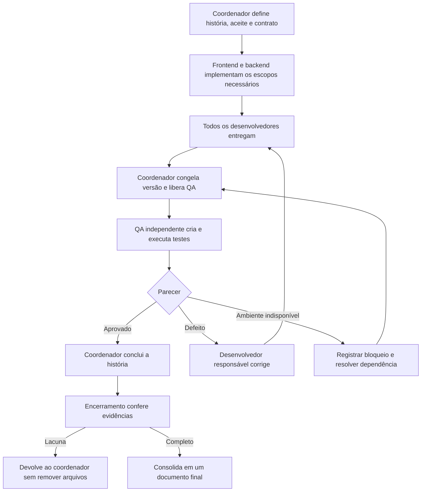

# Equipe de agentes do Autoluguel

Criada em 22/10/2026 a pedido do responsável. Política: quem desenvolve não cria os testes da própria entrega. O especialista de testes atua depois dos desenvolvedores.

## Papéis persistentes

| Papel | Arquivo | Responsabilidade |
|---|---|---|
| Coordenador | [AGENTS.md](../../AGENTS.md) e este fluxo | Definir fatia, distribuir arquivos, acompanhar entregas, liberar QA e consolidar resultado |
| Produto | [product.toml](../../.codex/agents/product.toml) | Refinar ideias e histórias, explicitar valor, escopo, dependências, dúvidas e critérios observáveis antes do desenvolvimento |
| Frontend | [frontend.toml](../../.codex/agents/frontend.toml) | React, TypeScript, Material UI, telas, acessibilidade e integração com contrato |
| Backend | [backend.toml](../../.codex/agents/backend.toml) | ASP.NET Core, domínio, autorização, EF Core/PostgreSQL, migrations e endpoints |
| QA independente | [qa.toml](../../.codex/agents/qa.toml) | Criar/manter testes, verificar critérios e emitir parecer após a entrega de desenvolvimento |
| Encerramento | [closeout.toml](../../.codex/agents/closeout.toml) | Conferir evidências de cada critério e consolidar documentos após QA aprovado e conclusão formal |

O coordenador é o agente principal da conversa. Os cinco perfis não fixam modelo nem nível de raciocínio. Instâncias de execução são criadas quando existe trabalho concreto; salvar os perfis não mantém agentes trabalhando em segundo plano.

Produto atua na preparação: recebe uma ideia ou história e entrega o [refinamento](templates/refinamento-produto.md) ao coordenador. Pode propor prioridade e divisão em fatias, mas não implementa, aprova QA ou conclui histórias. O coordenador consolida requisitos e contratos; decisões novas de produto ficam explícitas para o responsável. `REFINADO_PARA_COORDENACAO` indica requisitos suficientemente definidos para revisão; `AGUARDANDO_DECISAO` indica ambiguidade essencial. Dependências pendentes e Definition of Ready são registradas separadamente. Nenhum desses estados libera desenvolvimento automaticamente.

Exemplo de uso: “Use o agente product para refinar a história B04: confira o estado real, proponha critérios de aceite, dependências e dúvidas e entregue ao coordenador sem iniciar implementação.”

## Sequência obrigatória por história

1. **Preparação.** Escolher uma história, referências RF/RN, critérios observáveis, contrato e limites. Identificar arquivos por dono, dependências, dados sintéticos e instruções para executar. Não ampliar o escopo para preencher o tempo de outro agente.
2. **Desenvolvimento.** Backend estabiliza o contrato antes de frontend depender dele. Podem trabalhar em paralelo quando contrato e arquivos são independentes; caso contrário, trabalhar em sequência. Apenas um agente escreve cada arquivo compartilhado. QA ainda não é acionado.
3. **Entrega.** Cada desenvolvedor preenche [entrega de desenvolvimento](templates/entrega-desenvolvimento.md), incluindo identidade da instância e referência do conteúdo. Build/typecheck e testes existentes podem ser executados pelos desenvolvedores. A criação/alteração de testes fica para QA.
4. **Liberação.** Coordenador confere todas as entregas e registra `LIBERADO_PARA_QA`. Identifica a versão por commit, se houver Git limpo, ou manifesto de hashes dos arquivos de produto/configuração revisados. Usa [controle da rodada](templates/controle-da-rodada.md). Bloqueia novas escritas de produto nessa rodada.
5. **QA.** Criar uma instância distinta com os critérios e as entregas. QA lê requisitos para formar expectativas, inspeciona implementação e cria/executa testes. A ordem é uma barreira de execução: não iniciar QA antecipadamente para depois apenas comparar resultados.
6. **Correção.** QA relata defeito sem corrigir produto. Coordenador encerra/pausa a rodada, aciona o desenvolvedor responsável, recebe nova entrega e congela nova versão. QA volta apenas depois. Erro no próprio teste pode ser corrigido pelo QA com fundamento no requisito, nunca para acomodar um bug.
7. **Conclusão.** Coordenador só marca a história concluída se o parecer independente for `APROVADO` e se corresponder à versão atual. Mudanças posteriores de produção invalidam o parecer anterior para os caminhos afetados.
8. **Encerramento documental.** Só após `APROVADO` e `CONCLUIDA`, o coordenador aciona `closeout` e entrega critérios aceitos, evidências, versão e inventário exato dos documentos exclusivos da tarefa. O agente devolve lacunas com `DEVOLVIDO_A_COORDENACAO`, sem remover arquivos; o coordenador decide sobre reabertura e nova rodada de QA. Se tudo estiver comprovado, usa o [modelo de entrega final](templates/entrega-final.md), preserva as evidências e atualiza referências atribuídas antes de remover os transitórios recuperáveis e autorizados. O resultado é `ENCERRAMENTO_CONSOLIDADO`. Nenhuma etapa é disparada automaticamente pelo TOML.

## Propriedade dos arquivos

- Frontend: `apps/web/src`, HTML, assets, estilos e configuração de aplicação. Exclui testes e configuração Playwright.
- Produto: propostas de refinamento; pode escrever em `docs/produto/` e nos itens atribuídos de `docs/backlog.md` somente com atribuição explícita. PRD, regras e ADRs passam pelo coordenador. Não escreve código, contratos ou testes.
- Backend: `src/`, entidades, casos de uso, configurações EF e migrations. Exclui projetos/fixtures de teste.
- QA: `tests/`, `apps/web/e2e/`, `*.test.*`, `*.spec.*`, configuração Playwright, fixtures/snapshots de teste e `docs/qa/`.
- Encerramento: `docs/entregas/<ID>.md`, documentos transitórios exclusivos enumerados pelo coordenador e referências documentais expressamente atribuídas. Preserva documentação compartilhada, código, testes e contratos.
- Compartilhados: OpenAPI, manifests/lockfiles de pacotes, solução .NET, CI e infraestrutura. O coordenador nomeia **um escritor por vez**. QA pode alterar manifests/solução/CI apenas para dependências, descoberta ou execução de testes na sua fase; requisitos, contrato e código de produto continuam fora de sua autoria.
- Documentação de produto e decisões: coordenador consolida; especialistas propõem alterações com justificativa. Nenhum agente muda requisito para transformar falha em sucesso.

Os escopos acima são instruções de trabalho, não barreiras de segurança impostas pelo sistema operacional. A independência depende de instâncias distintas, histórico de autoria, revisão dos arquivos alterados e coordenação. Não se trata de um pipeline automaticamente imposto pelos arquivos TOML.

## Entrada e resultados

Pacote mínimo para desenvolvimento: história, objetivo, critérios RF/RN, contrato, arquivos permitidos, dependências e referência de origem. Pacote para QA acrescenta entregas de todos os desenvolvedores envolvidos, autores, versão congelada, passos de execução e registro de liberação.

| Estado | Emitido por | Significado |
|---|---|---|
| EM_DESENVOLVIMENTO | Coordenador | Implementação em andamento; QA não inicia |
| PRONTO_PARA_QA | Desenvolvedor | Sua parte entregue; não representa aprovação |
| LIBERADO_PARA_QA | Coordenador | Todos os escopos necessários entregues, versão identificada |
| AGUARDANDO_ENTREGA | QA | Falta pacote/liberação; não iniciou a validação |
| APROVADO | QA | Critérios e verificações pertinentes comprovados na versão registrada |
| REPROVADO | QA | Defeito ou critério não atendido; volta ao desenvolvimento |
| BLOQUEADO | Qualquer papel | Dependência/ambiente impede conclusão; informar o que falta |
| CONCLUIDA | Coordenador | História concluída após parecer aprovado na versão pertinente; habilita o encerramento documental |
| AGUARDANDO_CONCLUSAO | Encerramento | Falta condição de entrada; nenhuma escrita ou limpeza |
| DEVOLVIDO_A_COORDENACAO | Encerramento | Lacuna de evidência, versão ou inventário; coordenador decide o encaminhamento |
| ENCERRAMENTO_CONSOLIDADO | Encerramento | Evidências preservadas no registro final e transitórios autorizados removidos |

Uma história só de backend dispensa frontend, e vice-versa; registrar “não aplicável”. O mesmo agente desenvolvedor não pode ser convertido em QA da sua alteração. Modelos iguais em contextos distintos podem exercer papéis separados; mudar apenas o nome da mesma instância não produz independência. Testes anteriores à criação desta política são preservados e não recebem certificação retroativa.

## Usar os perfis

O formato `.codex/agents/*.toml` segue a [documentação oficial de subagentes](https://learn.chatgpt.com/docs/agent-configuration/subagents), consultada em 22/10/2026. Cada perfil tem `name`, `description` e `developer_instructions`; permissões seguem a sessão pai.

Para descoberta nativa, iniciar uma sessão no projeto Autoluguel com um cliente que suporte esses perfis. A conversa atual está na pasta pai; criar os arquivos aqui não comprova que foram carregados automaticamente nesta sessão. Se a ferramenta de delegação não expuser seleção por perfil, o coordenador deve ler o TOML e repassar integralmente suas instruções à instância correspondente. Nunca afirmar ativação nativa sem evidência.

Exemplo de pedido para o próximo incremento:

> Implemente a história B04 com os especialistas frontend e backend do Autoluguel. Respeite as dependências do backlog e estabilize o contrato antes de integrar as telas. Depois de receber as entregas de desenvolvimento, acione uma instância QA independente para criar e executar os testes. Corrija os defeitos com os desenvolvedores e repita QA antes de concluir.

Nenhuma história de produto é iniciada apenas pela criação destes perfis. O exemplo B04 depende de B02 conforme o backlog.
